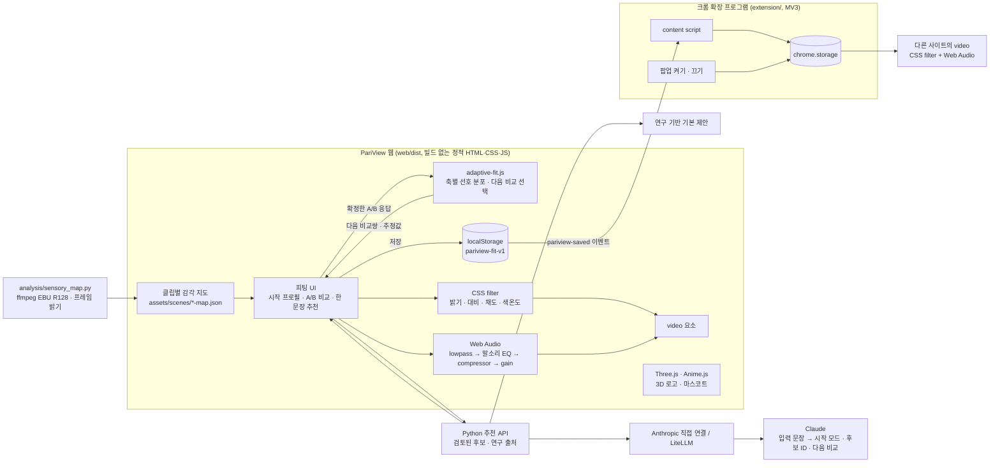

# PariView

**화면과 소리, 내가 정하면 안 되나요?**

- **문제** 영화의 밝기와 소리는 하나의 기본값으로 나오지만, 편한 빛과 소리는 사람마다, 보는 곳마다 달라요
- **해법** 불편한 점을 한 문장으로 적어 시작 설정을 추천받거나 직접 비교를 시작해요 같은 장면에서 편한 쪽을 고르면 다음 비교값이 달라지고, 확정한 설정은 지원되는 브라우저 영상에도 이어서 적용해요

2026 이화여대 공과대학 캡스톤디자인 사회기여형 · 팀 Lucent (정아윤, 박세령, 정서윤)
의학의 평가 관점과 감각 연구를 참고해, 사용자가 직접 비교하고 조절하는 시청 선호 피팅 서비스예요

## 핵심 구현

| 핵심 | PariView가 구현한 것 | 공개 웹 상태 (2026-11-04) |
|---|---|---|
| **선택에 따라 달라지는 적응형 피팅** | 밝기·대비·음량의 선호 분포를 갱신하고, 기대 정보이득이 큰 다음 A/B 비교를 선택하는 클라이언트 엔진 | 구현·배포 완료 · 엔진 23개 및 브라우저 6개 통합 흐름 통과 |
| **한 문장으로 시작하는 AI 추천** | 자유 입력을 Claude에 전달하고, 검토된 모드·설정 후보와 다음 비교 항목을 선택하게 하는 추천 API·미리보기 UI | 구현·배포 완료 · 학교 LiteLLM 경로의 실제 AI 응답·적용·저장 1회 확인 |

AI 추천은 **시작점을 제안**하고, 적응형 피팅은 **사용자의 선택을 바탕으로 값을 추정**해요 피팅 엔진은 브라우저 안에서 동작하며 LLM을 호출하지 않아요

## 데모와 실행

- 웹 데모: [PariView 바로 열기](https://pariview-production.up.railway.app/)
- 로컬 실행: `HOST=127.0.0.1 PORT=4178 python3 ai/server.py` → http://127.0.0.1:4178
- Claude 추천 연결: [환경변수·API 안내](ai/README.md) · Anthropic 직접 연결과 LiteLLM 게이트웨이를 지원해요 로컬에서 키를 설정하지 않아도 기본 제안을 이용할 수 있어요
- 크롬 확장 프로그램 v0.3.1: 웹스토어 심사 제출 완료 · 검토 대기 중이에요 공개 설치 전에는 [`pariview-extension.zip`](pariview-extension.zip)을 풀고 `chrome://extensions`에서 개발자 모드 → 압축해제된 확장 프로그램 로드로 시험할 수 있어요 · [설치 안내](extension/README.md)

확장은 지원되는 HTML 영상의 화면 설정을 조절해요 소리 조절은 비DRM·동일 출처 또는 CORS 허용 등 조건이 필요하며, YouTube에서 확인했어요 Netflix 소리 지원은 확인하지 않았어요

## 화면

| 첫 화면 | 시청 스튜디오 |
|:---:|:---:|
|  |  |
| **시작 프로필 고르기** | **선택에 따라 달라지는 A/B 비교** |
|  |  |
| **연구 기반 추천** | **다른 장면 고르기** |
|  |  |
| **크롬에서 쓰기** | **모바일** |
|  |  |

영상 신호로 측정한 감각 지도

위 이미지는 `web/dist`를 실제로 실행한 화면이에요 (1440×900, 390×844)

## 이용 흐름

1. **방법 고르기** ‘직접 설정하기’에서 다섯 가지 시작 프로필을 고르거나 ‘연구 기반 PariView 추천받기’에서 불편한 점을 한 문장으로 적거나 오늘의 필요와 환경을 골라요 추천값은 이유와 출처를 확인하고 수정·미리보기할 수 있어요
2. **내 선택에 따라 달라지는 비교** 밝기·대비·음량을 5회 비교하며, 앞선 선택으로 선호 범위를 갱신하고 다음 A/B 값을 골라요 원하면 5회씩 더 비교할 수 있어요 화면은 같은 순간을 함께 재생하고 소리는 작은 쪽부터 한쪽씩 들어요 비교 속도는 0.75배예요 ‘비슷해요’·‘잘 모르겠어요’·‘건너뛰기’는 따로 기록하고 추정값을 바꾸지 않아요
3. **맞춘 설정으로 보기** 추정한 밝기·대비·음량을 확인하고, 음량 변화 완화와 쉬운 자막은 결과 화면에서 직접 골라요 고른 설정으로 영상을 보고 저장해요 크롬 확장 프로그램이 같은 설정을 지원되는 다른 사이트 영상에도 적용해요 언제든 다시 맞추거나 원본과 비교하거나 기본값으로 돌아갈 수 있어요

| 시작 프로필 | 이럴 때 |
|---|---|
| 자극을 편안하게 | 소리와 빛에 민감한 날이라면 |
| 이야기에 집중 | 이야기의 흐름을 따라가고 싶다면 |
| 조금 더 또렷하게 | 또렷하게 듣고 크게 보고 싶다면 |
| 부드럽게 시작 | 부드러운 화면과 쉬운 말이 필요하다면 |
| 평소처럼 편안하게 | 평소 화면과 소리를 조금씩 맞추고 싶다면 |

시작 프로필은 고쳐 쓸 수 있는 출발점이에요 실제 값은 [`web/dist/settings.js`](web/dist/settings.js)에 있어요

**영상은 세 작품에서 45초씩, 총 2분 15초**를 제공해요 ‘장면 고르기’에서 Tears of Steel의 연구실, Sintel의 대화와 도시, Big Buck Bunny의 밝은 초원을 바꿔 볼 수 있어요

장면을 바꾸면 측정된 밝기·소리 특징에 따라 현재 값을 조금 조절해요 ‘장면 맞춤’에서 이유를 확인하고 원래대로 되돌리거나 자동 조절을 끌 수 있어요 이전 보정은 쌓이지 않고 직접 바꾼 값은 남으며, 저장 버튼을 누르기 전에는 브라우저에 저장한 설정이나 확장 프로그램에 전달하지 않아요 이 장면별 조절은 측정값에 따른 규칙으로 동작해요

## 선택을 따라 바뀌는 적응형 피팅

`A/B 선택 → 축별 선호 분포 갱신 → 기대 정보이득이 큰 다음 비교 선택`

심리물리학의 적응형 비교 원리를 참고해, PariView의 세 설정 축에 맞는 **베이지안 선호 추정·다음 비교 선택 엔진**을 구현했어요 각 축의 후보 선호값에 확률을 두고, A/B 응답으로 확률을 갱신한 뒤 불확실성을 더 줄일 것으로 예상되는 비교쌍을 골라요

| 항목 | 동작 |
|---|---|
| 추정 대상 | 밝기·대비·음량 3축 · 축별 101개 격자점의 선호 분포와 중앙값 추정 |
| 다음 비교 | 처음 세 번은 축마다 한 번씩 확인하고, 이후에는 앞선 응답을 반영한 기대 정보이득으로 비교쌍 선택 |
| 진행 횟수 | 5회로 시작 · 원하면 5회씩 추가 · 세션당 최대 20회 · 중간 종료·이전 응답 수정 지원 |
| 응답 확정 | A/B를 고른 뒤 ‘다음 비교’를 누를 때 확정 · ‘비슷해요’·‘잘 모르겠어요’·‘건너뛰기’는 따로 기록하고 선호 분포는 유지 |
| 토글 설정 | 음량 변화 완화·쉬운 자막은 결과에서 직접 선택 · 변경 후 추가 비교하면 새 조건의 세션으로 시작 |

5회는 **초기 탐색 횟수**예요 수렴 판정과 구분하며, 5회 안에 선호값에 도달한다고 보장하지 않아요 설정 조건을 바꿔 새 세션을 시작하면 이전 세션의 기록도 보존해요

비교 중에는 설정을 저장하거나 확장 프로그램으로 보내지 않아요 결과에서 확정할 때만 저장하며, 비교값·선택·장면·재생 속도·추정값은 사용자가 원할 때 JSON 파일로 내려받을 수 있어요 기록을 서버로 업로드하지 않아요

[엔진 소스](web/dist/adaptive-fit.js) · [알고리즘 계약](research/adaptive-fitting/CONTRACT.txt) · [설계 근거](research/adaptive-fitting/RESEARCH_BASIS.txt)

실제 앱 엔진으로 **합성 선호 500개를 5개 조건에서 고정·적응형 방식으로 각각 실행**했어요 두 방식은 같은 3축·추정기·5회 예산을 사용하며, 그래프는 비교 횟수에 따른 평균 정규화 절대오차(NMAE)를 보여줘요 이 오차는 각 축의 설정 범위로 나눈 추정값과 합성 선호값의 차이를 평균한 값이에요

모델 일치 조건의 5회 후 오차는 **고정 0.1498 → 적응형 0.1381**이었어요 응답 변동이 큰 조건에서는 차이가 불확실해요 이 수치는 실제 사람의 시청 편안함이나 SUS 점수가 아니에요

당사자 참여 검증은 완료했으며, 당시 비교별 값·응답·별도 선호값은 기록하지 않았어요 따라서 실제 참여자의 오차 곡선·±5 이내 인원·재피팅 일치율은 아직 산출하지 않았어요 [다음 기록 방법](research/adaptive-fitting/HUMAN_RECORDING.txt)과 [재현 방법·전체 결과](research/adaptive-fitting/README.txt)를 제공해요

## 한 문장으로 시작하는 AI 추천

`불편한 점 한 문장 + 선택 항목 + 현재 설정 → Claude 후보 선택 → 응답 검증 → 이유·초기값 표시 → 미리보기·수정·확정`

“폭발 장면에서 깜짝 놀라요”처럼 불편한 점을 적으면, Claude가 검토된 시작 모드·설정 후보와 다음 비교 항목을 골라요 현재 모드를 유지할 수도 있으며, 다른 모드를 제안해도 해당 프로필의 기본값을 통째로 덮어쓰지 않아요 사용자는 바뀔 값과 이유를 보고 적용할 항목을 결정해요

LLM은 허용된 후보 ID를 선택하고, 서버와 브라우저는 후보 간 충돌·기존 선택·허용 범위를 검사해요 화면에 표시하는 이유와 연구 출처는 검토된 카탈로그에서 구성해요 모델이 새 논문·진단·효과 수치나 임의의 설정값을 만들어 적용하지 않아요

**공개 웹 실제 응답 확인 · 2026-11-04**

| 입력·확인 항목 | 실제 결과 |
|---|---|
| 한 문장 입력 | “폭발 장면에서 깜짝 놀라요” · 선택 항목 없이 입력 |
| 연결 | 학교 LiteLLM 게이트웨이 → `claude-sonnet-4-6` · HTTP 200 · `source=ai` |
| 추천 | 현재 모드 유지 · 음량 변화 완화 켜기 · 장면 사전 안내 켜기 · 높은 소리 완화 15% · 다음 비교는 음량 |
| 사용자 값 | 기존 밝기 71·음량 28·노란 자막 선택 유지 |
| 화면·저장 | ‘AI 추천’ 표시와 확정 저장 확인 · 입력 문장은 브라우저 저장 공간에 남지 않음 |

위 화면은 실제 요청 1회의 결과예요 연결과 동작을 확인한 기록이며, 반복 성공률이나 추천 효과를 측정한 결과는 아니에요 장면 사전 안내는 현재 웹 시연 영상 3편에서 제공해요

자유 입력은 최대 300자이고, 추천 요청 시 서버와 연결된 Claude에 전달돼요 문장 원문은 브라우저 저장 공간에 남기지 않아요 연결이 없거나 응답 검증에 실패하면 **‘연구 기반 기본 제안’**으로 이어지고 문장이 반영되지 않았음을 알려줘요 실제 모델 응답이 검증된 결과에만 **‘AI 추천’**을 표시해요

[추천 API·연결 설정](ai/README.md) · [후보와 연구 카탈로그](web/dist/recommendation-data.json) · [응답 검증 코드](web/dist/recommendation-engine.js)

## 기술 구조

| 영역 | 사용 기술 |
|---|---|
| 화면 조절 | CSS filter (brightness, contrast, saturate, sepia), canvas 프레임 밝기 측정으로 어두운 장면 보정 |
| 소리 조절 | Web Audio API (BiquadFilter lowpass, 3kHz peaking EQ, DynamicsCompressor, Gain) |
| 감각 지도 | ffmpeg EBU R128 순간 라우드니스와 signalstats 프레임 평균 밝기로 변화 구간 측정 |
| 저장·연동 | localStorage, JSON 설정 내려받기, Chrome Extension Manifest V3 (content script, storage) |
| 그래픽 | Three.js 마스코트·로고, Anime.js 스프링 반응, GSAP, 모션 줄이기 지원 |
| 피팅 | 3축 독립 베이지안 선호 추정, 기대 정보이득에 따른 다음 비교 선택, 되돌리기·중단·추가 비교·JSON 기록 |
| 추천 | 한 문장 자유 입력, 검토된 모드·설정·출처 카탈로그, Claude Messages API·LiteLLM 연결, 응답 검증, 규칙 기반 기본 제안 |
| 배포 | Docker + Python 표준라이브러리 정적·추천 API 서버 (Railway), 영상 HTTP Range 지원 |

## 검증

| 항목 | 방법 | 결과 |
|---|---|---|
| 화면 동작 | `uv run --with playwright python web/validate.py` (1440·1280·768·390 폭, 5프로필, 비교, 저장, 초기화, 재생, 모바일, 모션 줄이기) | 오류 0건, 리소스 실패 0건 |
| 서버·추천 API | `python3 -m unittest ai.test_recommendation ai.test_experience_http ai.test_static_gzip -v` | 모의 공급자·HTTP·압축 등 50개 검사 통과 · 규칙 64개·AI 후보 17개 입력의 JS/Python 정합 |
| 추천 UI | `uv run --with playwright python web/validate_recommendation.py --base-url http://127.0.0.1:4178` | 모의 응답을 사용한 브라우저 14개 흐름 통과 · 실제 공급자 호출 없음 |
| 실제 AI 연결 | 공개 웹의 자유 입력 → 학교 LiteLLM → Claude | 별도 요청 1회에서 AI 응답·표시·설정 적용·저장 확인 (2026-11-04) |
| 영상 비교 | 3편 길이·장면 전환·12초 이후 탐색·동시 재생·0.75배속 확인 | 각 45초, 화면 동기화 및 설정 유지 통과 |
| 확장 프로그램 v0.3.1 | 웹 연결 6개, 오디오·상태 16개, 공개 앱 → 실제 YouTube·SPA 이동 10개 ([검증 기록](extension/tests/VALIDATION-0.3.1.md)) | 32개 항목 통과, 최종 ZIP 설치로 오디오·상태 16개 재확인 · 소리는 디지털 출력 신호로 확인 |
| 당사자 참여 검증 | 신경다양성 당사자 참여 · 완료 사실 사용자 확인 | 참여 검증 완료 · 비교별 수치 기록이 없어 정량 오차·SUS 점수 미산출 |
| 적응형 피팅 | `node web/test_adaptive_fit.mjs`, `uv run --with playwright python web/validate_adaptive.py --base-url http://127.0.0.1:4178` | 엔진 23개 통과, 실제 브라우저 6개 통합 흐름 통과 · 확정·되돌리기·추가 비교·조건 변경·기록·취소·저장·준비 중 재생 취소 포함 |
| 합성 비교 평가 | [동일 5회·3축·추정기 비교](research/adaptive-fitting/README.txt), 조건별 500건 × 5조건 × 2정책 | 5,000회 실행과 동일 seed 재현 확인 · 실제 참여자 수치와 구분 |

이전 고정 비교 방식의 [10종 시나리오 기록](analysis/simulation/REPORT.md)은 과거 구현 자료로 보관해요 현재 적응형 엔진의 성능이나 당사자의 시청 편안함·사용성(SUS) 점수로 쓰지 않아요

## 구현 범위와 한계

| 구분 | 내용 |
|---|---|
| 구현 | 직접 설정 / 연구 기반 추천 두 경로, 다섯 시작 프로필, 적응형 A/B 5회와 선택적 추가 비교, 비교 기록 내려받기, 추천 수정·미리보기·취소·확정, 3편 영상 선택, 밝기·대비·채도·색온도, 음량·고음 완화·말소리 강조·음량 변화 완화, 자막·쉬운 자막·자막 크기·노란 자막, 놓친 내용 기록, 20분 휴식 안내, 원본 비교, 저장·초기화·설정 파일 내려받기, 크롬 확장 연동, 영상 신호 기반 감각 지도 |
| 시연용 데이터 | 자막·쉬운 자막·요약·장면 기록은 데모 영상 3편에 맞춰 미리 작성했어요 감각 지도와 사전 예고 시점은 해당 영상의 빛·소리를 측정한 데이터에서 가져와요 |
| 설정 화면만 제공 | 배경음 줄이기와 장면 전환 완화는 실제 음원 분리나 프레임 보간을 하지 않아요 |
| 구현하지 않음 | 대사 분리, 개인별 불편 예측, 영상의 실시간 AI 분석, 감각 역치 측정 |
| 한계 | 연구는 개인차·환경 조절·비교 절차의 설계 근거예요 설정 수치나 AI 추천 성능, 감각 진단·치료 효과를 검증한 것은 아니에요 45초 구간으로 작품 전체를 대표하지 않아요 확장 프로그램의 소리는 DRM·CORS 등 지원 조건에 따라 제한되며 자막·장면 기록·사전 안내는 웹 시연 영상에서 제공해요 |

## 추후 개발 예정

**실제 참여자 정량 평가**

당사자를 포함한 성인 10명을 대상으로, 슬라이더로 확인한 참조 설정과 고정·적응형 비교 결과를 기록할 계획이에요 두 비교 방식의 순서를 교차하고 비교별 오차·±5 이내 도달·재피팅 일치율을 확인하며, 시청 편안함과 사용성(SUS)은 별도 항목으로 평가해요 기존 참여 검증을 이 실험의 수치로 대신하지 않아요

앱의 비교 기록 JSON과 [실제 기록·분석 절차](research/adaptive-fitting/HUMAN_RECORDING.txt), [제공용 실험·설문 서식](analysis/user-study/field-kit/README.txt)을 준비했어요

**유튜브·OTT 영상 사전 분석과 구간 예고**

지원 가능한 영상의 빛과 소리 변화를 재생 전에 분석하고, 확실히 큰 변화가 있는 구간만 미리 알려주는 기능을 개발할 예정이에요
작은 변화와 연속 알림을 걸러내고, 사용자가 빛·소리 예고를 켜거나 끌 수 있게 하는 방향이에요

현재 웹의 시연 영상 3편은 미리 측정한 구간 데이터를 사용해 예고해요
현재 크롬 확장 프로그램은 저장된 화면·소리 설정을 적용하며, 유튜브 영상을 미리 훑거나 미래 구간을 예고하는 기능은 아직 제공하지 않아요

**브라우저 소리 지원 범위 확대**

사용자가 확장을 직접 실행하고 권한을 부여하는 [Chrome tabCapture](https://developer.chrome.com/docs/extensions/reference/api/tabCapture/) 기반 탭 오디오 처리 방식을 검토할 예정이에요
현재는 미구현이며, DRM·OTT별 호환성과 재생·출력 복원은 별도로 검증할 계획이에요 Netflix 소리 지원이 확인된 상태는 아니에요

## 연구 근거

- [`research/literature-review.txt`](research/literature-review.txt): 논문 결과, 설계 해석, 적용 한계
- [`research/sources.json`](research/sources.json), [`research/medical-sensory-sources.json`](research/medical-sensory-sources.json): 서지와 확인 기록
- 웹의 "설계의 근거" 화면은 관찰된 연구 결과와 우리가 제안하는 경험을 구분해서 보여줘요

- [A1 포스터 PDF](poster/PariView_A1.pdf) · [이전 버전 기록](poster/versions/README.md)
- [연구 근거·설계 전략 PDF](PariView_Research_and_Strategy.pdf)
- [수상 사례·100점 심사 대응 PDF](research/award-patterns/PariView_Award_Strategy.pdf): 5개 대학 관련 대상 사례 10건과 포스터 구성·도입 모델 제안
- [제공용 실험·설문 서식](analysis/user-study/field-kit/README.txt): 실제 응답이 없는 별도 평가 설계예요

## 폴더

| 경로 | 내용 |
|---|---|
| `web/dist` | 웹 데모 소스 (index.html, app.js, settings.js, research.js, CSS, vendor) |
| `web/serve.py` | 로컬 서버 (HTTP Range 지원) |
| `ai/` | Python 정적·추천 API 서버, Claude 연결, 후보 검증과 테스트 |
| `web/dist/scenes.js`, `assets/scenes/` | 45초 영상 3편, 자막·장면 정보와 클립별 감각 지도 |
| `web/dist/recommendation*` | 추천 입력·수정·미리보기 UI와 검증된 후보·연구 카탈로그 |
| `web/dist/adaptive-fit.js`, `adaptive-ui.css` | 적응형 비교 엔진·피팅 화면 스타일 |
| `web/validate.py`, `web/validate_adaptive.py` | 화면 동작·적응형 통합 검증 |
| `research/adaptive-fitting/` | 알고리즘 계약·합성 평가·기록 변환·실제 참여자 빈 기록 양식 |
| `extension/` | 크롬 확장 프로그램 소스 |
| `analysis/sensory_map.py` | 감각 지도 측정 |
| `analysis/simulation/` | 사용자 시나리오 시뮬레이션 방법과 결과 |
| `analysis/user-study/field-kit/` | 제공용 실험 절차·설문지·빈 기록표·집계 스크립트 |
| `poster/` | A1 포스터 소스·PDF·이미지와 이전 버전 |
| `research/` | 문헌 정리와 출처 |
| `research/award-patterns/` | 수상 사례 출처·심사 대응 보고서·포스터 참고 자료 |
| `Dockerfile`, `deploy/` | Railway Python 서버 배포 설정과 운영 안내 |

## 오픈소스로 넓혀가는 시청 접근성

PariView가 작성한 소스 코드는 [MIT License](LICENSE)로 공개해요 화면·소리 조절과 확장 프로그램 코드를 누구나 검토하고 개선할 수 있어요
현재 검증한 유튜브 연동을 출발점으로, 커뮤니티와 함께 OTT별 플레이어 지원과 접근성 기능을 넓혀가요 각 서비스는 실제 검증을 거친 뒤 지원 목록에 추가해요
[기여 방법과 실행·검증 안내](CONTRIBUTING.md)에서 함께할 수 있는 작업을 확인할 수 있어요

## 출처와 라이선스

프로젝트의 MIT 라이선스는 PariView 자체 코드에 적용하며, 아래 제삼자 소재와 라이브러리의 라이선스를 대체하지 않아요

- 영화: Tears of Steel (00:47~01:32), Sintel (02:20~03:05), Big Buck Bunny (00:50~01:35) · Blender Foundation / 해당 작품 크레디트 · [CC BY 3.0](https://creativecommons.org/licenses/by/3.0/) · [클립별 출처와 변경 내역](web/dist/assets/FILM-LICENSE.txt)
- 글꼴: Pretendard, SIL Open Font License ([`OFL.txt`](web/dist/assets/OFL.txt))
- 라이브러리: Three.js, Anime.js, GSAP (라이선스는 `web/dist/vendor`)
- 전체 소재 출처는 웹의 [`credits.html`](web/dist/credits.html)에 있어요
