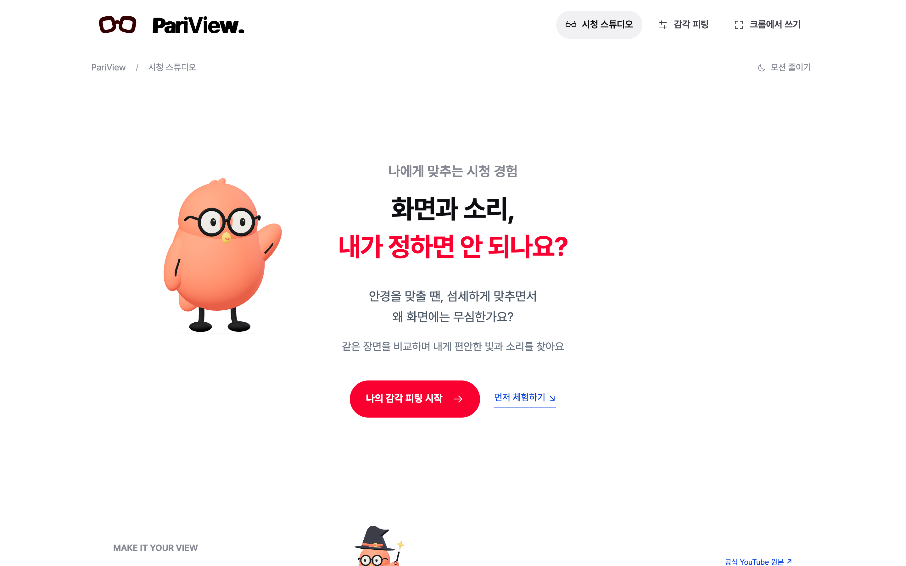
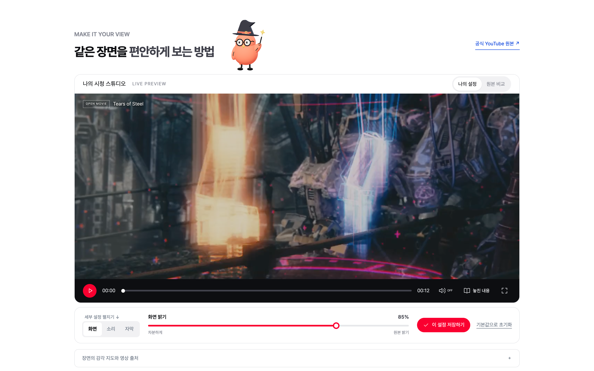
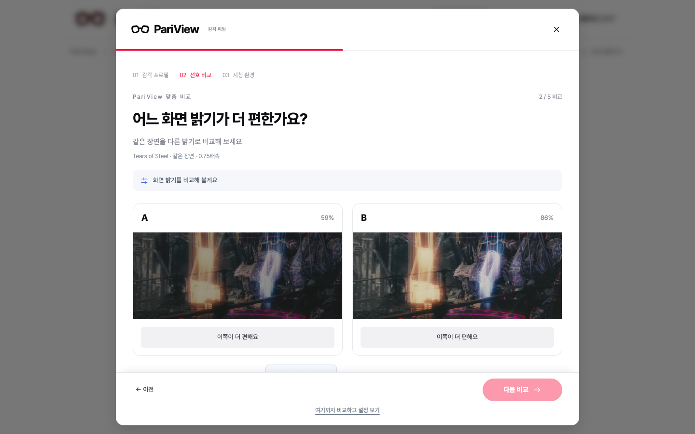
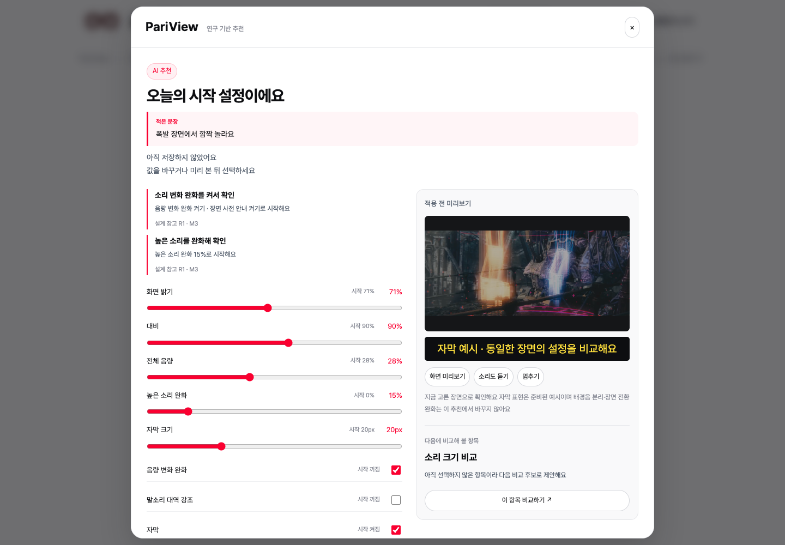
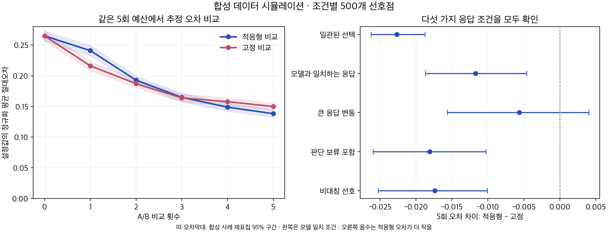
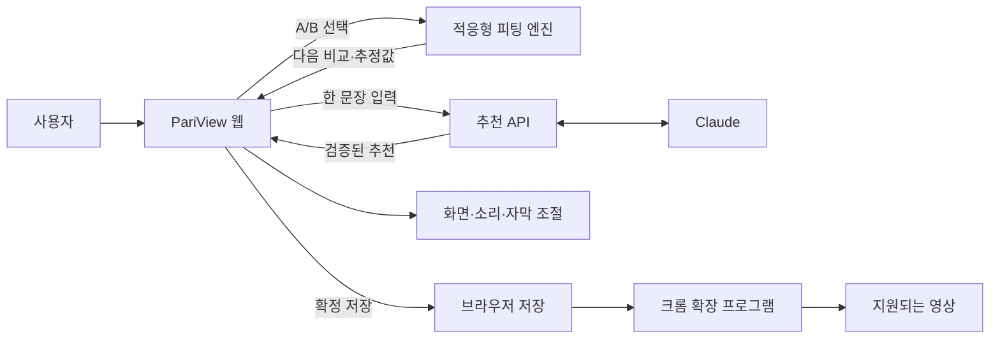

<div align="center">

<h1>PariView</h1>
<p><b>화면과 소리, 내가 정하면 안 되나요?</b></p>
<p>같은 장면을 비교하며 나에게 편안한 시청 설정을 찾는 서비스</p>

<a href="https://pariview-production.up.railway.app/"></a>
<a href="https://youtu.be/53o3VVO-jrE"></a>
<a href="poster/PariView_A1.pdf"></a>
<a href="https://github.com/ryeong03/pariview/actions/workflows/ci.yml"></a>

<br/><br/>


<p><b>한 문장으로 시작하고, 비교로 맞추고, 브라우저에서도 이어서</b></p>

</div>

---

## Overview

PariView는 빛·소리·자막을 개인의 선호에 맞게 조절하는 시청 환경 피팅 서비스예요 신경다양성 당사자를 포함해 영상의 밝기나 갑작스러운 소리 변화에 불편을 느끼는 사용자를 위해 만들었어요

불편한 점을 적으면 AI가 시작 설정을 제안하고, 같은 장면에서 편한 쪽을 고르면 적응형 피팅이 다음 비교를 바꿔요 확정한 설정은 저장하고 지원되는 브라우저 영상에서도 이어서 사용할 수 있어요

| 구성 | 역할 |
| --- | --- |
| 시청 웹앱 | AI 추천, A/B 비교, 화면·소리·자막 조절, 원본 비교와 저장 |
| 크롬 확장 프로그램 | 저장한 화면·소리 설정을 지원되는 다른 사이트 영상에 적용 |
| 추천 API | 한 문장 입력을 바탕으로 시작 모드·초기값·다음 비교 항목 제안 |

## Problem

같은 영상도 누구에게는 편안하고, 누구에게는 너무 밝거나 시끄러울 수 있어요 PariView는 사용자가 자신의 설정을 찾고 계속 조절할 수 있는 흐름에 집중해요

| 사용자가 겪는 어려움 | PariView의 접근 |
| --- | --- |
| 어떤 값을 바꿔야 할지 모르겠어요 | 불편한 점을 한 문장으로 적어 시작점 추천받기 |
| 슬라이더 숫자만으로는 차이를 모르겠어요 | 같은 장면의 A/B를 보고 듣고 선택하기 |
| 상황이 바뀌면 다시 조절하고 싶어요 | 저장한 값에서 재비교하고 원본·기본값으로 돌아가기 |

## Background

### 사용자 설문

팀 자체 온라인 설문 76명 응답 기준이며, 응답자 중 신경다양성 당사자는 20%예요

| 항목 | 결과 |
| --- | ---: |
| 기존 OTT 관련 기능 만족도 | 11.8% |
| 기존 OTT 관련 세부 조절 기능 부족 | 60.5% |
| 맞춤형 시청각 자극 최적화 기술 사용 의향 | 83% |

<sub>탐색 목적의 온라인 설문으로, 전체 이용자를 대표하는 통계는 아니에요</sub>

### 연구에서 설계로

감각 경험 연구에서 보고된 개인차·상황 변화·조절권을 참고해, 하나의 정답을 정하기보다 사용자가 직접 비교하고 바꾸는 흐름을 설계했어요 [MacLennan et al., 2022](https://pmc.ncbi.nlm.nih.gov/articles/PMC9213348/)

자막 크기·색상 등 표시 방식을 사용자가 고를 수 있도록 한 것은 미디어 접근성 요구사항을 참고한 설계예요 [W3C Media Accessibility User Requirements](https://www.w3.org/TR/media-accessibility-reqs/#captioning)

## Solution

> 시작점 선택 → 같은 장면 비교 → 내 설정 확인 → 저장·적용 → 필요할 때 재조절

1. 불편한 점을 적어 추천받거나, 다섯 가지 시작 프로필에서 직접 시작해요
2. 같은 장면의 A/B 중 편한 쪽을 골라 밝기·대비·음량을 맞춰요
3. 결과를 미리 보고 수정한 뒤 저장해요 지원되는 브라우저 영상에서도 이어서 사용해요

## Key Features

| 기능 | 설명 |
| --- | --- |
| 적응형 A/B 피팅 | 이전 선택으로 선호 범위를 갱신하고 다음 비교값을 결정해요 5회로 시작해 원하면 추가 비교할 수 있어요 |
| 한 문장 AI 추천 | “폭발 장면에서 깜짝 놀라요”처럼 적으면 Claude가 검토된 후보에서 시작 설정과 다음 비교를 제안해요 |
| 맞춤 시청 스튜디오 | 밝기·대비·색감, 음량·높은 소리·음량 변화, 자막 크기·색상을 한곳에서 조절해요 |
| 큰 변화 사전 안내 | 시연 영상의 측정 데이터를 바탕으로 큰 빛·소리 변화 전에 예고해요 예고는 바로 켜고 끌 수 있어요 |
| 원본 비교와 되돌리기 | 적용 전 미리보기, 원본과 비교, 기본값 복원으로 설정을 다시 확인할 수 있어요 |
| 브라우저 설정 연동 | 웹에서 저장한 설정을 크롬 확장 프로그램으로 전달해 지원 영상에 적용해요 |

## Screenshots

<div align="center">

<p><sub>시청 스튜디오 · 영상을 보면서 설정을 바로 조절해요</sub></p>
</div>

| 적응형 A/B 비교 | AI 추천 |
| :---: | :---: |
|  |  |
| 앞선 선택에 따라 다음 비교가 달라져요 | 이유와 초기값을 확인한 뒤 적용해요 |

## Adaptive Fitting

피팅의 핵심은 <b>베이지안 선호 추정과 다음 비교 선택</b>이에요 밝기·대비·음량의 선호 분포를 두고, A/B 응답에 따라 갱신한 뒤 정보이득이 큰 다음 비교쌍을 골라요 이 계산은 브라우저에서 동작해요

- 세 축을 먼저 한 번씩 확인하고, 이후 비교는 앞선 선택을 반영해요
- 5회로 시작해 5회씩 추가할 수 있으며, 한 세션에서 최대 20회까지 비교해요
- 비슷함·판단 유보·건너뛰기를 구분하고, 이전 선택 수정과 중간 종료를 지원해요
- 음량 변화 완화와 쉬운 자막은 결과에서 직접 고를 수 있어요

<div align="center">

</div>

합성 선호 500개의 모델 일치 조건에서 5회 후 평균 정규화 오차는 고정 0.150, 적응형 0.138이었어요 응답 변동이 큰 조건에서는 차이가 불확실했어요 합성 평가 결과이며, 실제 사용자 효과나 5회 수렴을 보장하는 수치는 아니에요

[엔진 소스](web/dist/adaptive-fit.js) · [평가 방법과 재현](research/adaptive-fitting/README.txt)

## AI Recommendation

불편한 점 한 문장과 현재 설정을 받아 Claude가 시작 모드·설정 후보·다음 비교를 제안해요 추천 이유는 검토된 설정·연구 카탈로그에서 구성하고, 사용자가 미리 보고 수정한 뒤 확정해요

> “폭발 장면에서 깜짝 놀라요” → 음량 변화 완화·사전 안내 제안 → 미리보기·수정 → 적용

실제 AI 응답을 받아 적용·저장하는 흐름을 확인했어요 연결이 없으면 기본 제안으로 안내하며, 자유 입력 문장은 브라우저 저장 공간에 남기지 않아요

## System Architecture



## Tech Stack

| 영역 | 사용 기술 |
| --- | --- |
| Web | HTML · CSS · JavaScript · Three.js · Anime.js |
| Fitting | 베이지안 선호 추정 · 기대 정보이득 기반 A/B 선택 |
| Media | CSS filter · Web Audio API · ffmpeg 신호 측정 |
| AI | Python · Claude API · 추천 후보 검증 |
| Extension | Chrome Extension Manifest V3 · Chrome Storage |
| Deployment | Docker · Railway |

## Getting Started

```sh
HOST=127.0.0.1 PORT=4178 python3 ai/server.py
```

브라우저에서 `http://127.0.0.1:4178`을 열어요 AI 연결이 없어도 직접 피팅과 기본 제안을 사용할 수 있어요

- [AI 설정·개발 안내](ai/README.md)
- [크롬 확장 프로그램 설치 안내](extension/README.md) · 웹스토어 심사 중이며 개발자 모드로 시험할 수 있어요
- [기여·검증 안내](CONTRIBUTING.md)

시연은 45초 영상 3편으로 제공해요 쉬운 자막·놓친 내용은 해당 영상에 맞춰 작성한 데이터이고, 사전 안내는 미리 측정한 구간을 사용해요 확장 프로그램은 지원되는 HTML 영상에 적용되며, 소리 조절은 DRM·CORS·플레이어 조건에 따라 제한돼요

## Roadmap

- 실제 참여자의 피팅 정확도·편안함·사용성 정량 평가
- 지원 영상의 사전 분석과 큰 변화 구간 예고
- 교육·영상 서비스의 플레이어 연동과 지원 범위 확대

## Repository Structure

| 경로 | 내용 |
| --- | --- |
| `web/dist/` | 웹앱·피팅 엔진·시청 설정 |
| `ai/` | 추천 API와 검증 |
| `extension/` | 크롬 확장 프로그램 |
| `analysis/` | 영상 신호 분석·평가 도구 |
| `research/` | 연구 근거·적응형 피팅 평가 |
| `docs/` | 서비스 화면과 문서 |
| `poster/` | 최신 포스터와 제작 소스 |

## Team

2026 이화여자대학교 공과대학 캡스톤디자인 · 사회기여형 · 팀 Lucent

| 정아윤 | 박세령 | 정서윤 |
| :---: | :---: | :---: |
| 기획·아이디어 | 개발·구현 | 연구 조사·콘텐츠 설계 |

## License

PariView 자체 코드는 [MIT License](LICENSE)를 따라요

시연 영상은 Blender Foundation 작품의 [CC BY 3.0 소재](web/dist/assets/FILM-LICENSE.txt)를 사용해요 글꼴·라이브러리 등 제삼자 소재의 출처와 라이선스는 [크레디트](web/dist/credits.html)에 정리했어요

---

<div align="center">
<p><b>PariView · 나에게 맞추는 시청 경험</b></p>
</div>
