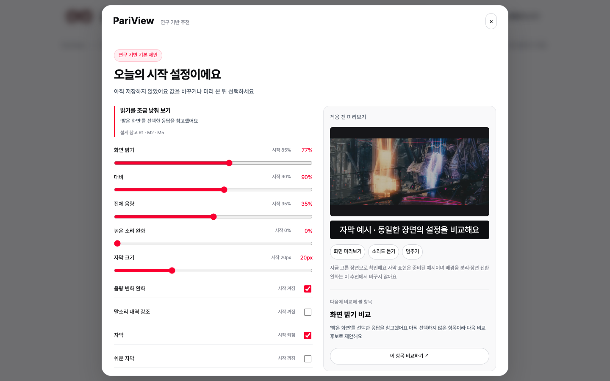
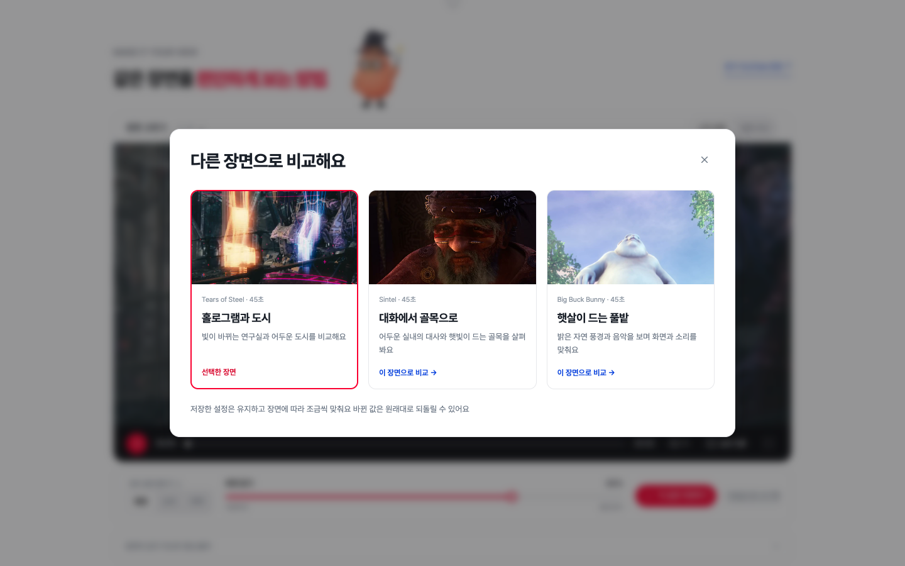
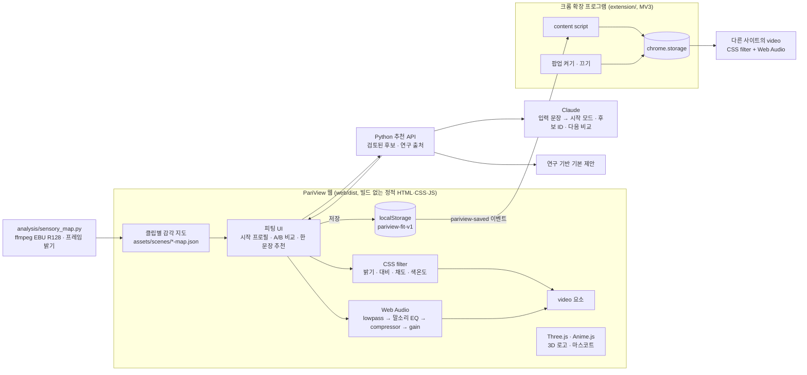

# PariView

**화면과 소리, 내가 정하면 안 되나요?**

- **문제** 영화의 밝기와 소리는 하나의 기본값으로 나오지만, 편한 빛과 소리는 사람마다, 보는 곳마다 달라요
- **해법** 같은 장면을 두 가지로 비교해 고른 밝기·대비·소리를 저장하고, 크롬 확장 프로그램으로 다른 영상에도 이어서 적용해요

2026 이화여대 공과대학 캡스톤디자인 사회기여형 · 팀 Lucent (정아윤, 박세령, 정서윤)
의학의 평가 관점과 감각 연구를 참고해, 사용자가 직접 비교하고 조절하는 시청 선호 피팅 서비스예요

## 데모

- 웹 데모: [PariView 바로 열기](https://pariview-production.up.railway.app/)
- 로컬 실행: `HOST=127.0.0.1 PORT=4178 python3 ai/server.py` → http://127.0.0.1:4178
- Claude 추천 연결: [Railway 환경변수 안내](ai/README.md) · 키를 설정하기 전에도 연구 기반 기본 제안을 이용할 수 있어요
- 크롬 확장 프로그램: [`pariview-extension.zip`](pariview-extension.zip)을 풀고 `chrome://extensions`에서 개발자 모드 → 압축해제된 확장 프로그램을 로드합니다 · [설치 안내](extension/README.md)

## 화면

| 첫 화면 | 시청 스튜디오 |
|:---:|:---:|
|  |  |
| **시작 프로필 고르기** | **같은 장면 A/B 비교** |
|  |  |
| **연구 기반 추천** | **다른 장면 고르기** |
|  |  |
| **크롬에서 쓰기** | **모바일** |
|  |  |

영상 신호로 측정한 감각 지도

모든 이미지는 `web/dist`를 실제로 실행한 화면이에요 (1440×900, 390×844)

## 이용 흐름

1. **방법 고르기** ‘직접 설정하기’에서 다섯 가지 시작 프로필을 고르거나 ‘연구 기반 PariView 추천받기’에서 불편한 점을 한 문장으로 적거나 오늘의 필요와 환경을 골라요 추천값은 이유와 출처를 확인하고 수정·미리보기할 수 있어요
2. **내 선택에 따라 달라지는 비교** 밝기·대비·음량을 5회 비교하며, 앞선 선택으로 선호 범위를 갱신하고 다음 A/B 값을 골라요 원하면 5회씩 더 비교할 수 있어요 화면은 같은 순간을 함께 재생하고 소리는 작은 쪽부터 한쪽씩 들어요 비교 속도는 0.75배예요 ‘비슷해요’·‘잘 모르겠어요’·‘건너뛰기’는 따로 기록하고 추정값을 바꾸지 않아요
3. **맞춘 설정으로 보기** 추정한 밝기·대비·음량을 확인하고, 음량 변화 완화와 쉬운 자막은 결과 화면에서 직접 골라요 고른 설정으로 영상을 보고 저장해요 크롬 확장 프로그램이 같은 설정을 다른 사이트 영상에도 적용해요 언제든 다시 맞추거나 원본과 비교하거나 기본값으로 돌아갈 수 있어요

| 시작 프로필 | 이럴 때 |
|---|---|
| 자극을 편안하게 | 소리와 빛에 민감한 날이라면 |
| 이야기에 집중 | 이야기의 흐름을 따라가고 싶다면 |
| 조금 더 또렷하게 | 또렷하게 듣고 크게 보고 싶다면 |
| 부드럽게 시작 | 부드러운 화면과 쉬운 말이 필요하다면 |
| 평소처럼 편안하게 | 평소 화면과 소리를 조금씩 맞추고 싶다면 |

시작 프로필은 고쳐 쓸 수 있는 출발점이에요 실제 값은 [`web/dist/settings.js`](web/dist/settings.js)에 있어요

**영상은 세 작품에서 45초씩, 총 2분 15초**를 제공해요 ‘장면 고르기’에서 Tears of Steel의 연구실, Sintel의 대화와 도시, Big Buck Bunny의 밝은 초원을 바꿔 볼 수 있어요

장면을 바꾸면 측정된 밝기·소리 특징에 따라 현재 값을 조금 조절해요 ‘장면 맞춤’에서 이유를 확인하고 원래대로 되돌리거나 자동 조절을 끌 수 있어요 이전 보정은 쌓이지 않고 직접 바꾼 값은 남으며, 저장 버튼을 누르기 전에는 브라우저에 저장한 설정이나 확장 프로그램에 전달하지 않아요 이 장면별 조절은 측정값에 따른 규칙으로 동작해요

“폭발 장면에서 깜짝 놀라요”처럼 불편한 점을 한 문장으로 적으면, 연결된 Claude가 검토된 시작 모드·설정 후보와 다음 비교 항목을 골라요 추천 시작 모드와 바뀐 초기값을 함께 보여주며 기존 프로필 값을 통째로 덮어쓰지 않아요 이유와 출처는 검증한 카탈로그에서 구성해요

자유 입력은 최대 300자이며, 연결된 Claude에 추천을 요청할 때 전달돼요 문장 원문은 브라우저 저장 공간에 남기지 않아요 AI 연결이 없거나 응답을 검증하지 못하면 ‘연구 기반 기본 제안’으로 이어지고 문장이 반영되지 않았음을 알려줘요 실제 모델 응답이 검증된 결과에만 ‘AI 추천’을 표시하며, 설정은 사용자가 확정할 때만 저장해요

## 선택을 따라 바뀌는 적응형 피팅

`A/B 선택 → 축별 선호 분포 갱신 → 기대 정보이득이 큰 다음 비교 선택`

밝기·대비·음량의 세 축을 먼저 한 번씩 확인하고, 남은 비교는 앞선 응답을 반영해 골라요 5회로 시작해 최대 20회까지 이어갈 수 있으며, 중간 종료와 이전 응답 수정도 가능해요 음량 변화 완화·쉬운 자막을 바꾼 뒤 다시 비교하면 새 조건으로 5회를 시작하고 이전 기록은 별도 세션으로 보존해요

비교 중에는 설정을 저장하거나 확장 프로그램으로 보내지 않아요 결과에서 확정할 때만 저장하며, 비교값·선택·장면·재생 속도·추정값은 사용자가 원할 때 JSON 파일로 내려받을 수 있어요 기록을 서버로 업로드하지 않아요

이 그래프는 실제 앱 엔진을 이용한 **합성 데이터 평가**예요 같은 3축과 5회 예산으로 비교했으며, 모델 일치 조건 500건의 평균 정규화 오차는 고정 0.1498, 적응형 0.1381이에요 응답 변동이 큰 조건에서는 차이가 불확실해요 5회 안의 수렴이나 편안함 향상을 보장하는 결과로 해석하지 않아요

당사자 참여 검증은 완료했다고 확인받았지만, 당시 비교별 값·응답·별도 선호값은 기록하지 않았어요 실제 참여자 오차 곡선은 만들지 않았으며 [다음 기록 방법](research/adaptive-fitting/HUMAN_RECORDING.txt)과 [재현 방법·전체 결과](research/adaptive-fitting/README.txt)를 따로 제공해요

## 기술 구조

| 영역 | 사용 기술 |
|---|---|
| 화면 조절 | CSS filter (brightness, contrast, saturate, sepia), canvas 프레임 밝기 측정으로 어두운 장면 보정 |
| 소리 조절 | Web Audio API (BiquadFilter lowpass, 3kHz peaking EQ, DynamicsCompressor, Gain) |
| 감각 지도 | ffmpeg EBU R128 순간 라우드니스와 signalstats 프레임 평균 밝기로 변화 구간 측정 |
| 저장·연동 | localStorage, JSON 설정 내려받기, Chrome Extension Manifest V3 (content script, storage) |
| 그래픽 | Three.js 마스코트·로고, Anime.js 스프링 반응, GSAP, 모션 줄이기 지원 |
| 피팅 | 3축 독립 베이지안 선호 추정, 기대 정보이득에 따른 다음 비교 선택, 되돌리기·중단·추가 비교·JSON 기록 |
| 추천 | 한 문장 자유 입력, 검토된 모드·설정·출처 카탈로그, Claude Messages API, 응답 검증, 규칙 기반 기본 제안 |
| 배포 | Docker + Python 표준라이브러리 정적·추천 API 서버 (Railway), 영상 HTTP Range 지원 |

## 검증

| 항목 | 방법 | 결과 |
|---|---|---|
| 화면 동작 | `uv run --with playwright python web/validate.py` (1440·1280·768·390 폭, 5프로필, 비교, 저장, 초기화, 재생, 모바일, 모션 줄이기) | 오류 0건, 리소스 실패 0건 |
| 추천 | `python3 -m unittest ai.test_recommendation ai.test_experience_http ai.test_static_gzip -v`, `uv run --with playwright python web/validate_recommendation.py --base-url http://127.0.0.1:4178` | 서버 전체 검사 50개 통과, 규칙 64개·AI 후보 17개 입력의 JS/Python 정합, 브라우저 14개 흐름 통과 · 모의 공급자 회귀와 별도로 학교 LiteLLM 경로의 공개 실요청 1회 AI 응답·설정 적용·저장 확인 (2026-11-04) |
| 영상 비교 | 3편 길이·장면 전환·12초 이후 탐색·동시 재생·0.75배속 확인 | 각 45초, 화면 동기화 및 설정 유지 통과 |
| 확장 프로그램 v0.3.1 | 웹 연결 6개, 오디오·상태 16개, 공개 앱 → 실제 YouTube·SPA 이동 10개 ([검증 기록](extension/tests/VALIDATION-0.3.1.md)) | 32개 항목 통과, 최종 ZIP 설치로 오디오·상태 16개 재확인 · 소리는 디지털 출력 신호로 확인 |
| 당사자 참여 검증 | 신경다양성 당사자 참여 · 사용자 확인 | 완료 |
| 적응형 피팅 | `node web/test_adaptive_fit.mjs`, `uv run --with playwright python web/validate_adaptive.py --base-url http://127.0.0.1:4178` | 엔진 23개 통과, 실제 브라우저 6개 통합 흐름 통과 · 확정·되돌리기·추가 비교·조건 변경·기록·취소·저장·준비 중 재생 취소 포함 |
| 합성 비교 평가 | [동일 5회·3축·추정기 비교](research/adaptive-fitting/README.txt), 조건별 500건 × 5조건 × 2정책 | 5,000회 실행과 동일 seed 재현 확인 · 실제 참여자 수치와 구분 |

이전 고정 비교 방식의 [10종 시나리오 기록](analysis/simulation/REPORT.md)은 과거 구현 자료로 보관해요 현재 적응형 엔진의 성능이나 당사자의 시청 편안함·사용성(SUS) 점수로 쓰지 않아요

## 구현 범위와 한계

| 구분 | 내용 |
|---|---|
| 구현 | 직접 설정 / 연구 기반 추천 두 경로, 다섯 시작 프로필, 적응형 A/B 5회와 선택적 추가 비교, 비교 기록 내려받기, 추천 수정·미리보기·취소·확정, 3편 영상 선택, 밝기·대비·채도·색온도, 음량·고음 완화·말소리 강조·음량 변화 완화, 자막·쉬운 자막·자막 크기·노란 자막, 놓친 내용 기록, 20분 휴식 안내, 원본 비교, 저장·초기화·설정 파일 내려받기, 크롬 확장 연동, 영상 신호 기반 감각 지도 |
| 시연용 데이터 | 자막·쉬운 자막·요약·장면 기록은 데모 영상 3편에 맞춰 미리 작성했어요 감각 지도와 사전 예고 시점은 해당 영상의 빛·소리를 측정한 데이터에서 가져와요 |
| 설정 화면만 제공 | 배경음 줄이기와 장면 전환 완화는 실제 음원 분리나 프레임 보간을 하지 않아요 |
| 구현하지 않음 | 대사 분리, 개인별 불편 예측, 영상의 실시간 AI 분석, 감각 역치 측정 |
| 한계 | 연구는 개인차·환경 조절·비교 절차의 설계 근거예요 설정 수치나 AI 추천 성능, 감각 진단·치료 효과를 검증한 것은 아니에요 45초 구간으로 작품 전체를 대표하지 않아요 확장 프로그램의 소리는 DRM·CORS 등 지원 조건에 따라 제한되며 자막·장면 기록·사전 안내는 웹 시연 영상에서 제공해요 |

## 추후 개발 예정

**유튜브·OTT 영상 사전 분석과 구간 예고**

지원 가능한 영상의 빛과 소리 변화를 재생 전에 분석하고, 확실히 큰 변화가 있는 구간만 미리 알려주는 기능을 개발할 예정이에요
작은 변화와 연속 알림을 걸러내고, 사용자가 빛·소리 예고를 켜거나 끌 수 있게 하는 방향이에요

현재 웹의 시연 영상 3편은 미리 측정한 구간 데이터를 사용해 예고해요
현재 크롬 확장 프로그램은 저장된 화면·소리 설정을 적용하며, 유튜브 영상을 미리 훑거나 미래 구간을 예고하는 기능은 아직 제공하지 않아요

**브라우저 소리 지원 범위 확대**

사용자가 확장을 직접 실행하고 권한을 부여하는 [Chrome tabCapture](https://developer.chrome.com/docs/extensions/reference/api/tabCapture/) 기반 탭 오디오 처리 방식을 검토할 예정이에요
현재는 미구현이며, DRM·OTT별 호환성과 재생·출력 복원은 별도로 검증할 계획이에요 Netflix 소리 지원이 확인된 상태는 아니에요

## 연구 근거

- [`research/literature-review.txt`](research/literature-review.txt): 논문 결과, 설계 해석, 적용 한계
- [`research/sources.json`](research/sources.json), [`research/medical-sensory-sources.json`](research/medical-sensory-sources.json): 서지와 확인 기록
- 웹의 "설계의 근거" 화면은 관찰된 연구 결과와 우리가 제안하는 경험을 구분해서 보여줘요

- [A1 포스터 PDF](poster/PariView_A1.pdf) · [이전 버전 기록](poster/versions/README.md)
- [연구 근거·설계 전략 PDF](PariView_Research_and_Strategy.pdf)
- [수상 사례·100점 심사 대응 PDF](research/award-patterns/PariView_Award_Strategy.pdf): 5개 대학 관련 대상 사례 10건과 포스터 구성·도입 모델 제안
- [제공용 실험·설문 서식](analysis/user-study/field-kit/README.txt): 실제 응답이 없는 별도 평가 설계예요

## 폴더

| 경로 | 내용 |
|---|---|
| `web/dist` | 웹 데모 소스 (index.html, app.js, settings.js, research.js, CSS, vendor) |
| `web/serve.py` | 로컬 서버 (HTTP Range 지원) |
| `ai/` | Python 정적·추천 API 서버, Claude 연결, 후보 검증과 테스트 |
| `web/dist/scenes.js`, `assets/scenes/` | 45초 영상 3편, 자막·장면 정보와 클립별 감각 지도 |
| `web/dist/recommendation*` | 추천 입력·수정·미리보기 UI와 검증된 후보·연구 카탈로그 |
| `web/dist/adaptive-fit.js`, `adaptive-ui.css` | 적응형 비교 엔진·피팅 화면 스타일 |
| `web/validate.py`, `web/validate_adaptive.py` | 화면 동작·적응형 통합 검증 |
| `research/adaptive-fitting/` | 알고리즘 계약·합성 평가·기록 변환·실제 참여자 빈 기록 양식 |
| `extension/` | 크롬 확장 프로그램 소스 |
| `analysis/sensory_map.py` | 감각 지도 측정 |
| `analysis/simulation/` | 사용자 시나리오 시뮬레이션 방법과 결과 |
| `analysis/user-study/field-kit/` | 제공용 실험 절차·설문지·빈 기록표·집계 스크립트 |
| `poster/` | A1 포스터 소스·PDF·이미지와 이전 버전 |
| `research/` | 문헌 정리와 출처 |
| `research/award-patterns/` | 수상 사례 출처·심사 대응 보고서·포스터 참고 자료 |
| `Dockerfile`, `deploy/` | Railway Python 서버 배포 설정과 운영 안내 |

## 오픈소스로 넓혀가는 시청 접근성

PariView가 작성한 소스 코드는 [MIT License](LICENSE)로 공개해요 화면·소리 조절과 확장 프로그램 코드를 누구나 검토하고 개선할 수 있어요
현재 검증한 유튜브 연동을 출발점으로, 커뮤니티와 함께 OTT별 플레이어 지원과 접근성 기능을 넓혀가요 각 서비스는 실제 검증을 거친 뒤 지원 목록에 추가해요
[기여 방법과 실행·검증 안내](CONTRIBUTING.md)에서 함께할 수 있는 작업을 확인할 수 있어요

## 출처와 라이선스

프로젝트의 MIT 라이선스는 PariView 자체 코드에 적용하며, 아래 제삼자 소재와 라이브러리의 라이선스를 대체하지 않아요

- 영화: Tears of Steel (00:47~01:32), Sintel (02:20~03:05), Big Buck Bunny (00:50~01:35) · Blender Foundation / 해당 작품 크레디트 · [CC BY 3.0](https://creativecommons.org/licenses/by/3.0/) · [클립별 출처와 변경 내역](web/dist/assets/FILM-LICENSE.txt)
- 글꼴: Pretendard, SIL Open Font License ([`OFL.txt`](web/dist/assets/OFL.txt))
- 라이브러리: Three.js, Anime.js, GSAP (라이선스는 `web/dist/vendor`)
- 전체 소재 출처는 웹의 [`credits.html`](web/dist/credits.html)에 있어요
