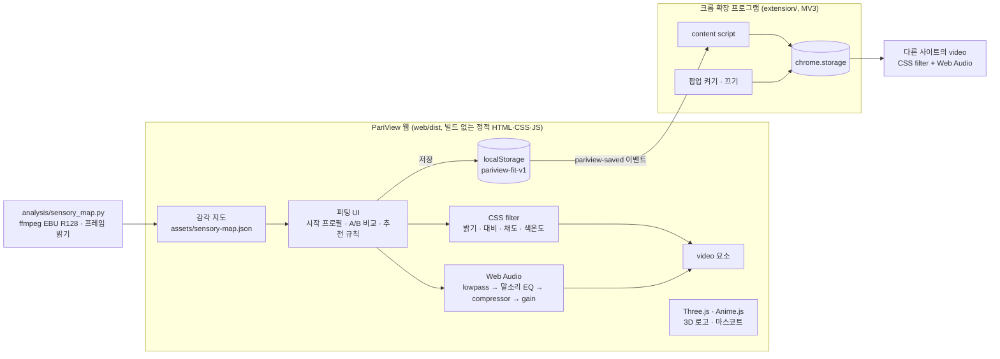

# PariView

**화면과 소리, 내가 정하면 안 되나요?**

- **문제** 영화의 밝기와 소리는 하나의 기본값으로 나오지만, 편한 빛과 소리는 사람마다, 보는 곳마다 달라요
- **해법** 같은 장면을 두 가지로 비교해 고른 밝기·대비·소리를 저장하고, 크롬 확장 프로그램으로 다른 영상에도 이어서 적용해요

2026 이화여대 공과대학 캡스톤디자인 사회기여형 · 팀 Lucent (정아윤, 박세령, 정서윤)
포스터 세션과 현장 데모를 위한 PoC예요

## 데모

- 웹 데모: [PariView 바로 열기](https://pariview-production.up.railway.app/)
- 로컬 실행: `python3 web/serve.py` → http://127.0.0.1:4178
- 크롬 확장 프로그램: [`pariview-extension.zip`](pariview-extension.zip)을 풀고 `chrome://extensions`에서 개발자 모드 → 압축해제된 확장 프로그램을 로드합니다

## 화면

| 첫 화면 | 시청 스튜디오 |
|:---:|:---:|
|  |  |
| **시작 프로필 고르기** | **같은 장면 A/B 비교** |
|  |  |
| **크롬에서 쓰기** | **모바일** |
|  |  |

영상 신호로 측정한 감각 지도

모든 이미지는 `web/dist`를 실제로 실행한 화면이에요 (1440×900, 390×844)

## 이용 흐름

1. **시작 프로필 고르기** 다섯 가지 시작 설정 중 오늘과 가까운 것을 골라요 질문 두 개로 시작 프로필을 추천받을 수도 있어요
2. **같은 장면 비교하기** 밝기, 대비, 소리 크기, 음량 변화 완화, 쉬운 자막을 A/B로 비교해요 비슷하면 "비슷해요", 모르겠으면 건너뛰어요
3. **맞춘 설정으로 보기** 고른 설정으로 영상을 보고 저장해요 크롬 확장 프로그램이 같은 설정을 다른 사이트 영상에도 적용해요 언제든 다시 맞추거나 원본과 비교하거나 기본값으로 돌아갈 수 있어요

| 시작 프로필 | 이럴 때 |
|---|---|
| 자극을 편안하게 | 소리와 빛에 민감한 날이라면 |
| 이야기에 집중 | 이야기의 흐름을 따라가고 싶다면 |
| 조금 더 또렷하게 | 또렷하게 듣고 크게 보고 싶다면 |
| 부드럽게 시작 | 부드러운 화면과 쉬운 말이 필요하다면 |
| 평소처럼 편안하게 | 평소 화면과 소리를 조금씩 맞추고 싶다면 |

시작 프로필은 의학적 분류가 아니라 고쳐 쓸 수 있는 출발점이에요 실제 값은 [`web/dist/settings.js`](web/dist/settings.js)에 있어요

## 기술 구조

| 영역 | 사용 기술 |
|---|---|
| 화면 조절 | CSS filter (brightness, contrast, saturate, sepia), canvas 프레임 밝기 측정으로 어두운 장면 보정 |
| 소리 조절 | Web Audio API (BiquadFilter lowpass, 3kHz peaking EQ, DynamicsCompressor, Gain) |
| 감각 지도 | ffmpeg EBU R128 순간 라우드니스와 signalstats 프레임 평균 밝기로 변화 구간 측정 |
| 저장·연동 | localStorage, JSON 설정 내려받기, Chrome Extension Manifest V3 (content script, storage) |
| 그래픽 | Three.js, Anime.js, GSAP |
| 배포 | Docker + Nginx (Railway), 로컬은 HTTP Range를 지원하는 `web/serve.py` |

## 검증

| 항목 | 방법 | 결과 |
|---|---|---|
| 화면 동작 | `uv run --with playwright python web/validate.py` (1440·1280·768·390 폭, 5프로필, 비교, 저장, 초기화, 재생, 모바일, 모션 줄이기) | 오류 0건, 리소스 실패 0건 |
| 확장 프로그램 | Chromium에 `--load-extension`으로 설치해 연결 → 저장 → 다른 페이지 적용 → 초기화 → 끄고 켜기 → 재생 유지 | 6개 항목 통과 |
| 피팅 흐름 | [AI 페르소나 10명 시뮬레이션](analysis/simulation/REPORT.md) 대상층별 페르소나가 실제 UI로 피팅을 끝까지 진행 | 원하는 값과의 평균 오차 0.189 → 0.077, 10명 모두 오차 감소, 켜기/끄기 항목 일치 70% → 100% |

시뮬레이션은 페르소나마다 정해둔 목표값에 피팅 흐름이 얼마나 다가가는지를 확인한 결과예요 고정된 두 값 중에서만 고르는 구조라 큰 소리가 필요한 페르소나는 최대 선택지에서 멈추는 한계도 함께 찾았어요

## 구현 범위와 한계

| 구분 | 내용 |
|---|---|
| 구현 | 다섯 시작 프로필, 5단계 A/B 비교, 2문항 시작 프로필 추천(규칙 기반), 밝기·대비·채도·색온도, 음량·고음 완화·말소리 강조·음량 변화 완화, 자막·쉬운 자막·자막 크기, 놓친 내용 기록, 20분 휴식 안내, 원본 비교, 저장·초기화·설정 파일 내려받기, 크롬 확장 연동, 영상 신호 기반 감각 지도 |
| 시연용 예시 | 자막·쉬운 자막·요약·장면 사전 안내 문구는 현재 영상에 맞춰 미리 작성했어요 배경음 줄이기와 장면 전환 완화는 설정 화면만 있고 실제 음원 분리나 프레임 보간은 하지 않아요 |
| 구현하지 않음 | 대사 분리, 개인별 불편 예측, 실시간 AI 추론, 감각 역치 측정 |
| 한계 | 감각 진단이나 치료 효과를 검증하지 않았어요 추천은 연구를 참고한 선택 규칙이며 최적값을 찾는다고 보지 않아요 DRM 영상에서는 확장 프로그램이 화면 설정만 적용해요 소리 조절은 실제 청취로 검증하지 않았어요 현재 데모 영상은 12초 한 편이에요 |

## 연구 근거

- [`research/literature-review.txt`](research/literature-review.txt): 논문 결과, 설계 해석, 적용 한계
- [`research/sources.json`](research/sources.json), [`research/medical-sensory-sources.json`](research/medical-sensory-sources.json): 서지와 확인 기록
- 웹의 "설계의 근거" 화면은 관찰된 연구 결과와 우리가 제안하는 경험을 구분해서 보여줘요

## 폴더

| 경로 | 내용 |
|---|---|
| `web/dist` | 웹 데모 소스 (index.html, app.js, settings.js, research.js, CSS, vendor) |
| `web/serve.py` | 로컬 서버 (HTTP Range 지원) |
| `web/validate.py` | 화면 동작 검증 |
| `extension/` | 크롬 확장 프로그램 소스 |
| `analysis/sensory_map.py` | 감각 지도 측정 |
| `analysis/simulation/` | AI 페르소나 시뮬레이션, 실제 사용자 평가지 |
| `research/` | 문헌 정리와 출처 |
| `Dockerfile`, `deploy/` | Railway Nginx 배포 설정과 운영 안내 |

## 출처와 라이선스

- 영화: Tears of Steel (2012) © Blender Foundation, [CC BY 3.0](https://creativecommons.org/licenses/by/3.0/), 원본 00:47~00:59 발췌 ([`FILM-LICENSE.txt`](web/dist/assets/FILM-LICENSE.txt))
- 글꼴: Pretendard, SIL Open Font License ([`OFL.txt`](web/dist/assets/OFL.txt))
- 라이브러리: Three.js, Anime.js, GSAP (라이선스는 `web/dist/vendor`)
- 전체 소재 출처는 웹의 [`credits.html`](web/dist/credits.html)에 있어요
