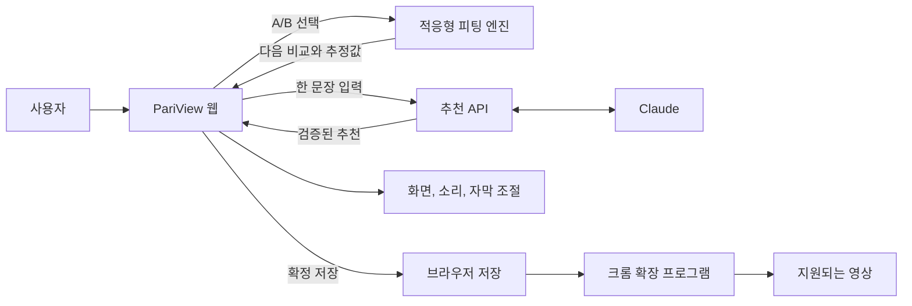

<div align="center">

<h1>PariView</h1>
<p><b>화면과 소리, 내가 정하면 안 되나요?</b></p>
<p>같은 장면을 비교하며 나에게 편안한 시청 설정을 찾는 서비스</p>

<a href="https://pariview-production.up.railway.app/"></a>
<a href="https://youtu.be/53o3VVO-jrE"></a>
<a href="poster/PariView_A1.pdf"></a>
<a href="https://github.com/ryeong03/pariview/actions/workflows/ci.yml"></a>

<br/><br/>


</div>

---

## Overview

PariView는 빛, 소리, 자막을 내 선호에 맞게 조절하는 시청 환경 피팅 서비스예요
신경다양성 당사자를 포함해 영상의 밝기나 갑작스러운 소리 변화가 불편한 사람을 위해 만들었어요

**3분 안에 써보기**

1. [라이브 데모](https://pariview-production.up.railway.app/)를 열어요
2. 첫 화면에서 `연구 기반 PariView 추천받기`나 `직접 설정하기`를 눌러요
3. 같은 장면의 A/B에서 편한 쪽을 5번 고르고, 결과를 확인한 뒤 저장해요

| 구성 | 역할 |
| --- | --- |
| 시청 웹앱 | AI 추천, A/B 비교, 화면, 소리, 자막 조절, 원본 비교, 저장 |
| 크롬 확장 프로그램 | 저장한 화면과 소리 설정을 지원되는 다른 사이트의 영상에 적용 |
| 추천 API | 한 문장 입력으로 시작 모드, 초기값, 다음 비교 항목을 제안 |

## Problem

같은 영상도 누구에게는 편안하고, 누구에게는 너무 밝거나 시끄러울 수 있어요
기존 플레이어의 설정은 숫자만 보여 주어서 무엇을 바꿔야 할지 알기 어려워요

| 사용자가 겪는 어려움 | PariView의 접근 |
| --- | --- |
| 어떤 값을 바꿔야 할지 모르겠어요 | 불편한 점을 한 문장으로 적어 시작점 추천받기 |
| 슬라이더 숫자만으로는 차이를 모르겠어요 | 같은 장면의 A/B를 보고 듣고 선택하기 |
| 상황이 바뀌면 다시 조절하고 싶어요 | 저장한 값에서 재비교하고 원본과 기본값으로 돌아가기 |

## Background

근거는 세 층으로 나눠 적어요
연구에서 확인된 것, 연구를 바탕으로 한 설계 추론, 아직 검증하지 못한 제품 효과예요

### 팀 자체 설문

구글폼 온라인 설문 76명 응답이고, 응답자 중 신경다양성 당사자는 20%예요
아래 비율은 모두 76명 전체 기준이에요

| 항목 | 결과 |
| --- | ---: |
| 기존 OTT 관련 기능 만족도 | 11.8% |
| 기존 OTT 관련 세부 조절 기능 부족 | 60.5% |
| 맞춤형 시청각 자극 최적화 기술 사용 의향 | 83% |

<sub>탐색 목적의 비대표 표본이에요 원응답 수는 저장소에서 따로 검증하지 못했어요 동료심사 연구와 구분해서 읽어 주세요</sub>

### 연구에서 확인된 것

| 연구 | 확인된 내용 |
| --- | --- |
| [MacLennan 등, 2022](https://pmc.ncbi.nlm.nih.gov/articles/PMC9213348/) | 자폐 성인의 온라인 설문에서 감각 경험은 사람마다 달랐고 기분과 상황에 따라 변했어요 |
| [Unwin 등, 2022](https://pmc.ncbi.nlm.nih.gov/articles/PMC9340127/) | 자폐 아동이 감각실을 직접 조절한 조건에서 주의집중이 더 높았어요 불안, 긍정정서, 각성에는 유의한 차이가 없었어요 |
| [Yosef 등, 2026](https://pmc.ncbi.nlm.nih.gov/articles/PMC13377290/) | 예고 단서가 있는 자극에서, 자폐 집단 안의 높은 감각 과반응은 기대 자극에 대한 억제 감소와 연관됐어요 |
| [김경민, 2010](https://www.kci.go.kr/kciportal/ci/sereArticleSearch/ciSereArtiView.kci?sereArticleSearchBean.artiId=ART001481865) | 소규모 ADHD 아동 연구에서 소리를 더한 조건의 과제 수행이 나아졌어요 자극을 무조건 줄이는 접근은 일반화하기 어려워요 |

이 연구들은 영상 시청 서비스의 효과를 검증한 것이 아니에요
표본은 대부분 자폐 집단이라 신경다양성 전체로 일반화하지 않아요
전체 서지와 한계는 [research/sources.json](research/sources.json)과 [research/literature-review.txt](research/literature-review.txt)에 있어요

### 연구를 바탕으로 한 설계 추론

| 설계 | 참고한 연구 |
| --- | --- |
| 소리와 빛 조절을 나누고 상황에 따라 바꿀 수 있게 해요 진단명으로 자동 설정하지 않아요 | MacLennan 등 |
| 조절, 해제, 원본 복귀의 결정권을 사용자에게 둬요 | Unwin 등 |
| 사전 안내를 모두에게 켜진 알림이 아니라 사용자가 고르는 기능으로 둬요 | Yosef 등 |
| 하나의 정답 대신 직접 비교하며 찾게 해요 5회로 시작하는 것은 팀의 설계 선택이에요 | 위 연구의 원칙을 적용 |

자막 크기와 색상을 고르게 한 것은 [W3C 미디어 접근성 요구사항](https://www.w3.org/TR/media-accessibility-reqs/#captioning)을 참고한 설계예요

### 아직 검증하지 못한 것

불안 감소, 감각 과부하 예방, 시청 중단 감소, 완주율 향상, 의학적 안전은 이 연구들로 입증되지 않았어요
실제 참여자 자료도 아직 없어서 PariView의 사용성과 편안함 효과는 검증 전이에요

## Solution

> 시작점 선택 → 같은 장면 비교 → 내 설정 확인 → 저장과 적용 → 필요할 때 재조절

1. 불편한 점을 적어 추천받거나, 다섯 가지 시작 프로필에서 직접 시작해요
2. 같은 장면의 A/B 중 편한 쪽을 골라 밝기, 대비, 음량을 맞춰요
3. 결과를 미리 보고 고친 뒤 저장해요 지원되는 브라우저 영상에서도 이어서 써요

## Key Features

| 기능 | 설명 |
| --- | --- |
| 적응형 A/B 피팅 | 이전 선택으로 선호 범위를 갱신하고 다음 비교값을 정해요 |
| 한 문장 AI 추천 | “폭발 장면에서 깜짝 놀라요”처럼 적으면 Claude가 검토된 후보에서 시작 설정과 다음 비교를 제안해요 |
| 맞춤 시청 스튜디오 | 밝기, 대비, 색감, 음량, 높은 소리, 음량 변화, 자막 크기와 색상을 한곳에서 조절해요 |
| 큰 변화 사전 안내 | 시연 영상의 측정 데이터로 큰 빛과 소리 변화를 미리 알려요 바로 켜고 끌 수 있어요 |
| 원본 비교와 되돌리기 | 적용 전 미리보기, 원본과 비교, 기본값 복원을 지원해요 |
| 브라우저 설정 연동 | 웹에서 저장한 설정을 크롬 확장 프로그램으로 전달해 지원 영상에 적용해요 |

## Screenshots

<div align="center">

<p><sub>시청 스튜디오에서 영상을 보면서 설정을 바로 조절해요</sub></p>
</div>

| 적응형 A/B 비교 | 시작 설정 제안 |
| :---: | :---: |
|  |  |
| 앞선 선택에 따라 다음 비교가 달라져요 | 값을 확인하고 미리 본 뒤 적용해요 |

<sub>시작 설정 제안 화면은 AI 연결 없이 나오는 연구 기반 기본 제안이에요</sub>

## Adaptive Fitting

밝기, 대비, 음량의 선호 분포를 두고 A/B 응답으로 갱신한 뒤, 정보이득이 큰 다음 비교쌍을 골라요
베이지안 선호 추정이고 계산은 브라우저에서 돌아가요

- 세 축을 먼저 한 번씩 확인하고, 이후 비교는 앞선 선택을 반영해요
- 5회로 시작해 5회씩 추가하고, 한 세션에서 최대 20회까지 비교해요
- 비슷함, 판단 유보, 건너뛰기를 구분하고 이전 선택 수정과 중간 종료를 지원해요
- 음량 변화 완화와 쉬운 자막은 결과에서 직접 골라요

<div align="center">

</div>

합성 선호 500개의 모델 일치 조건에서 5회 후 평균 정규화 오차는 고정 0.150, 적응형 0.138이었어요
응답 변동이 큰 조건에서는 차이가 불확실했어요
합성 평가 결과예요 실제 사용자 효과나 5회 수렴을 보장하는 수치가 아니에요

[엔진 소스](web/dist/adaptive-fit.js), [평가 방법과 재현](research/adaptive-fitting/README.txt)

## AI Recommendation

불편한 점 한 문장과 현재 설정을 받아 Claude가 시작 모드, 설정 후보, 다음 비교를 제안해요
추천 이유는 검토된 설정과 연구 카탈로그에서 구성하고, 사용자가 미리 보고 고친 뒤 확정해요

> “폭발 장면에서 깜짝 놀라요” → 음량 변화 완화와 사전 안내 제안 → 미리보기와 수정 → 적용

- AI 연결이 없거나 응답이 검증을 통과하지 못하면 기본 제안으로 안내해요
- 자유 입력 문장은 브라우저 저장 공간에 남기지 않아요
- 연결 설정은 [ai/README.md](ai/README.md)에 있어요

## System Architecture



## Tech Stack

| 영역 | 사용 기술 |
| --- | --- |
| Web | HTML, CSS, JavaScript, Three.js, Anime.js |
| Fitting | 베이지안 선호 추정, 기대 정보이득 기반 A/B 선택 |
| Media | CSS filter, Web Audio API, ffmpeg 신호 측정 |
| AI | Python, Claude API, 추천 후보 검증 |
| Extension | Chrome Extension Manifest V3, Chrome Storage |
| Deployment | Docker, Railway |

## Getting Started

가장 빠른 방법은 [라이브 데모](https://pariview-production.up.railway.app/)와 [소개 영상](https://youtu.be/53o3VVO-jrE)이에요

로컬에서 실행하려면 아래 명령을 써요 Python 표준 라이브러리만 필요해요

```sh
HOST=127.0.0.1 PORT=4178 python3 ai/server.py
```

브라우저에서 `http://127.0.0.1:4178`을 열어요 AI 연결이 없어도 직접 피팅과 기본 제안을 쓸 수 있어요

- [AI 설정과 개발 안내](ai/README.md)
- [크롬 확장 프로그램 설치 안내](extension/README.md) 웹스토어 심사 중이며 개발자 모드로 시험할 수 있어요
- [기여와 검증 안내](CONTRIBUTING.md)

**알아둘 점**

- 시연은 45초 영상 3편으로 제공해요
- 쉬운 자막과 놓친 내용은 해당 영상에 맞춰 미리 작성한 데이터예요
- 사전 안내는 미리 측정한 구간을 써요
- 확장 프로그램은 지원되는 HTML 영상에 적용돼요 소리 조절은 DRM, CORS, 플레이어 조건에 따라 제한돼요

## Roadmap

- 실제 참여자 대상 피팅 정확도, 편안함, 사용성 정량 평가
- 지원 영상의 사전 분석과 큰 변화 구간 예고
- 교육과 영상 서비스의 플레이어 연동, 지원 범위 확대

## Repository Structure

| 경로 | 내용 |
| --- | --- |
| `web/dist/` | 웹앱, 피팅 엔진, 시청 설정 |
| `ai/` | 추천 API와 검증 |
| `extension/` | 크롬 확장 프로그램 |
| `analysis/` | 영상 신호 분석과 평가 도구 |
| `research/` | 연구 근거와 적응형 피팅 평가 |
| `docs/` | 서비스 화면 이미지 |
| `poster/` | 최신 포스터와 제작 소스 |

## Team

2026 이화여자대학교 공과대학 캡스톤디자인, 사회기여형, 팀 Lucent

| 정아윤 | 박세령 | 정서윤 |
| :---: | :---: | :---: |
| 기획과 아이디어 | 개발과 구현 | 연구 조사와 콘텐츠 설계 |

## License

PariView 자체 코드는 [MIT License](LICENSE)를 따라요

시연 영상은 Blender Foundation 작품의 [CC BY 3.0 소재](web/dist/assets/FILM-LICENSE.txt)를 써요
글꼴과 라이브러리 등 제삼자 소재의 출처와 라이선스는 [크레디트](web/dist/credits.html)에 정리했어요

---

<div align="center">
<p><b>PariView, 나에게 맞추는 시청 경험</b></p>
</div>
